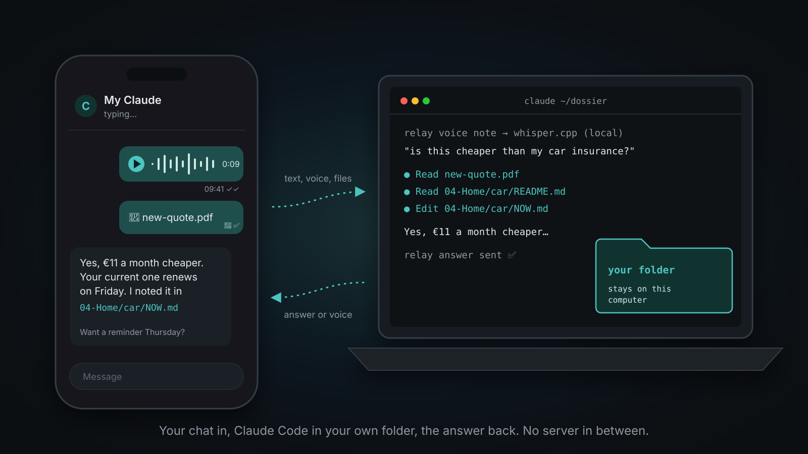
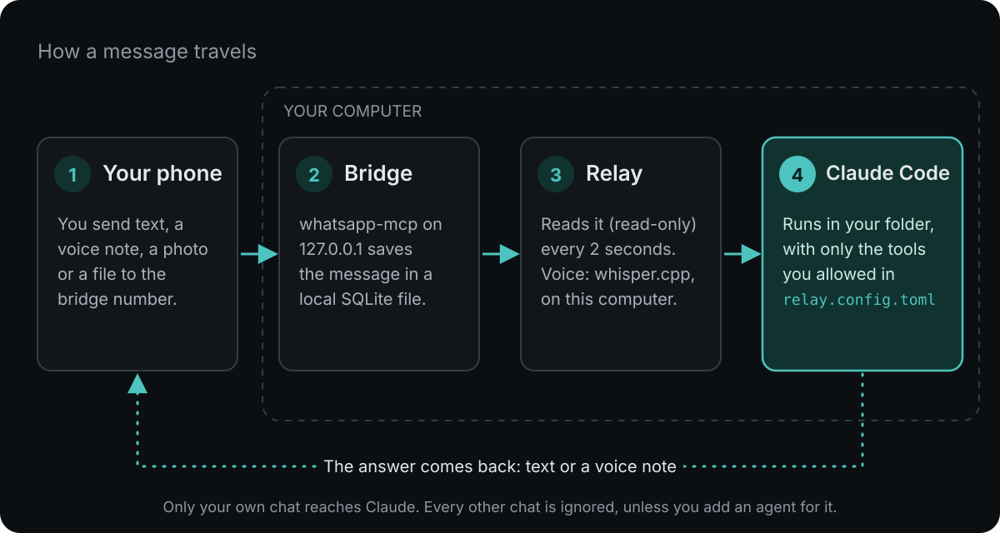

<p align="center">
  
</p>

<h1 align="center">claude-whatsapp-relay</h1>

<p align="center">
  Talk to <a href="https://code.claude.com/docs/en/overview">Claude Code</a> in your own folder, from WhatsApp.<br>
  Text, voice notes, photos and files go in. Answers (or voice notes) come back.<br>
  Everything runs on your own computer. No server in between.
</p>

---

> [!WARNING]
> **Read before you use it**
> 1. **Your chat becomes a remote control for your computer.** Whoever can write in it can steer Claude in your folder. See [SECURITY.md](SECURITY.md).
> 2. **The bridge is an unofficial WhatsApp client.** That breaks WhatsApp's Terms of Service, and the number can get banned. **Use a second number** for the bridge (a cheap prepaid SIM or eSIM), and message it from your normal number.

## Install (macOS)

One line. The installer asks before it installs, downloads or starts anything:

```bash
curl -fsSL https://raw.githubusercontent.com/clickspider/claude-whatsapp-relay/main/install.sh | bash
```

Safer: read the script first, then run it.

```bash
git clone https://github.com/clickspider/claude-whatsapp-relay.git
cd claude-whatsapp-relay
less install.sh            # read it
./install.sh --dry-run     # see every step, change nothing
./install.sh
```

What the installer does, in order:

| Step | What happens |
|---|---|
| 1. Tools | Checks `go`, `ffmpeg`, `whisper-cli`, Python 3.11+ and offers `brew install` for what is missing. Checks Claude Code. |
| 2. Settings | Asks your number, your name, your folder and your timezone. Writes them to `relay.config.toml` (mode 600). |
| 3. Bridge | Clones [whatsapp-mcp](https://github.com/verygoodplugins/whatsapp-mcp) at a fixed version, builds it, shows the QR code, waits until you scan it, then runs it in the background (launchd). |
| 4. Voice | Downloads the local whisper.cpp model (~550 MB). Voice notes never leave your computer. |
| 5. Check | Runs `relay.py check`: every setting with its risk, and every part tested. |
| 6. Start | Starts the relay in the background (launchd), and on every login. |

You need: macOS, [Homebrew](https://brew.sh), and Claude Code, signed in. The installer does not sign in for you: run `claude` once yourself first.
Run it again any time: it skips what is done. `./install.sh --uninstall` removes only what it created, and asks before it deletes data.

**One config file.** Every setting, the installer's too, lives in `relay.config.toml`. Change it, then run `./install.sh` again. Already run your own whatsapp-mcp bridge? Set `install.manage_bridge = false` and point `bridge.store` to its `store/` folder.

## Or: let Claude set it up with you

Paste this into Claude Code, inside your folder (for example a [dossier](https://github.com/clickspider/dossier-starter)):

```text
Clone https://github.com/clickspider/claude-whatsapp-relay into ./tools/claude-whatsapp-relay
and follow its SETUP.md with me, one question at a time.
```

## How it works

<p align="center">
  
</p>

1. The bridge stores incoming messages in a local SQLite file. The relay reads it (read-only) every 2 seconds.
2. A message from **your own chat** runs `claude -p --resume <session>` in your folder. The answer goes back over the bridge API on 127.0.0.1.
3. Voice notes are transcribed with `whisper-cli`. Answers can come back as voice (macOS `say`).

**Default = owner-only.** Every other chat is ignored until you add an agent for it in the config.

## What it does

| | |
|---|---|
| 🎙️ **Voice notes** | Transcribed on your computer with whisper.cpp. A voice note gets a voice note back (`owner.voice_replies`). Start a text with "voice" for the same. |
| 📎 **Files and photos** | Claude gets the file. Set `owner.media_dir` to copy every file into your folder. |
| 🔄 **`/new` with a hand-off** | A fresh conversation that starts with a short hand-off from the old one. Also automatic every day at 04:00 and when the context gets big. |
| 🧑‍🤝‍🧑 **Agents per contact** | Optional. A locked Claude for one contact or group, with its own role in `RULES.md` and its own folder. Replies wait for your `/<name> ok` until you trust it. |
| ↩️ **Quote-replies** | Claude can answer as a WhatsApp reply to one message. In a group, replying to the agent's message talks to it. |
| 🌙 **Quiet hours** | Agents never start a conversation at night or on your days off. Replies still go out. |
| 👀 **Feedback** | 👀 when it got your message, ⏳ on a long job, ✅ when done, "typing…" while Claude works. |

## Commands in your chat

- Anything: goes to your Claude. Start with "voice" to get a voice-note answer.
- `/new`: fresh conversation (a short hand-off carries over).
- For an agent named `alex`: `/alex ok` (send the held draft), `/alex status`, `/alex pause`, `/alex resume`, `/alex intro`, `/alex <your words>`, `/asalex <text>` (dry run: you play the contact).

## Set it up by hand

```bash
cp relay.config.example.toml relay.config.toml   # fill it in
scripts/get-model.sh                              # local speech model, ~550 MB
python3 relay.py check                            # every setting + its risk, and dependency checks
python3 relay.py plan                             # the exact claude commands, runs nothing
scripts/install-launchd.sh                        # macOS: writes the launchd job (add --load to start)
```

Needs: Python 3.11+, Claude Code, ffmpeg, whisper.cpp (`whisper-cli`), and a paired [whatsapp-mcp](https://github.com/verygoodplugins/whatsapp-mcp) bridge. Linux works without voice replies and launchd.

Settings, risks and setup: [SETUP.md](SETUP.md), [SECURITY.md](SECURITY.md) and [relay.config.example.toml](relay.config.example.toml).

## Tests

```bash
python3 -m unittest discover tests
```

## License

MIT. See [LICENSE](LICENSE). Builds on whatsapp-mcp (MIT) and whisper.cpp (MIT). Made by [Daniel Frey](https://www.danielfrey.me).
